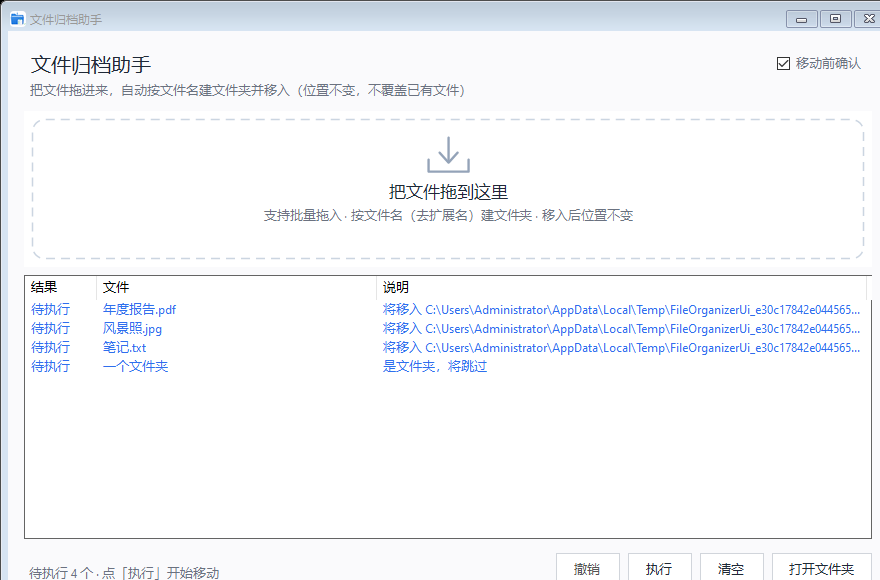
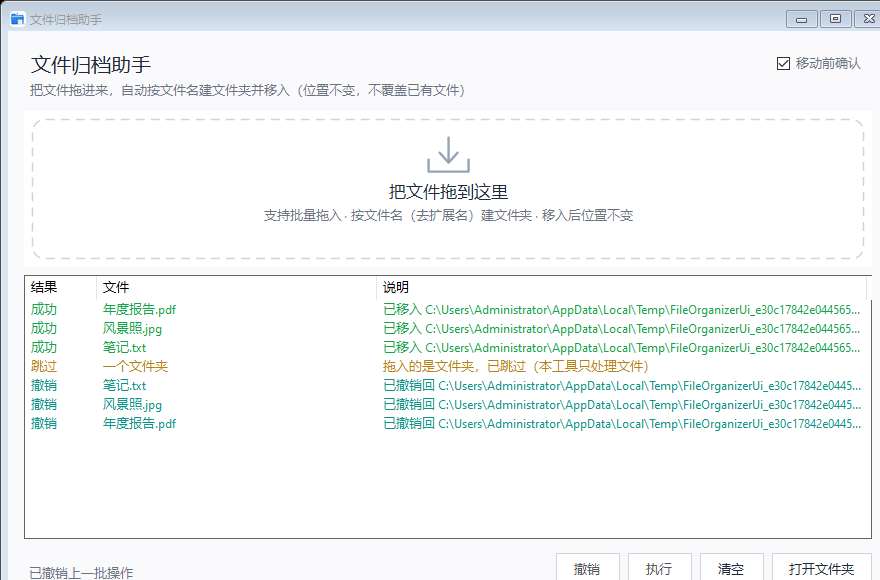

# 文件归档助手 · File Organizer

把文件拖进窗口，自动按**文件名（去扩展名）**在文件**原所在目录**建一个同名文件夹，并把文件移进去。默认**拖入先预览**、点「执行」才移动，且可**撤销**。零依赖、免安装运行时。

> 例：`D:\下载\report.pdf` → 生成 `D:\下载\report\report.pdf`

## 特性
- 拖拽批量归档：一次拖多个文件，逐个处理、互不影响
- 按文件名建夹：`report.pdf → report`；`my.report.pdf → my.report`
- 位置不变：文件夹就建在文件原目录，不搬到别处
- 安全优先：目标已有同名文件则**跳过、绝不覆盖**
- 默认预览确认：拖入只生成「待执行」预览（不动磁盘），点「执行」才移动
- 一键撤销：回退上一批移动（文件移回原位，仅删除本批新建且已空的文件夹）
- 边界防护：无扩展名文件（README/.gitignore）、已在同名夹、拖入文件夹、占用/权限异常都妥善处理
- 应用图标：exe / 窗口标题栏 / 任务栏图标，多分辨率清晰
- 免安装：基于 Windows 自带的 .NET Framework 4.8，双击即用

## 界面



*「移动前确认」开启时：拖入生成蓝色「待执行」预览，点「执行」移动*



*执行后绿色「成功」，撤销后青色「撤销」；黄色「跳过」/红色「失败」同样有标注*

## 下载与运行
到本仓库 **Releases** 下载 `Name2Dir.exe`，双击运行即可（Win10/Win11 自带 .NET Framework 4.8，无需安装任何东西）。

## 使用方法
1. 打开程序，把文件从资源管理器拖到窗口（虚线框或窗口任意位置）。
2. 默认进入预览：列表出现蓝色「待执行」行，说明列显示将要去向。
3. 点「执行」开始移动；结果按颜色显示：绿=成功、黄=跳过、红=失败、青=撤销。
4. 想直接拖入即移动，取消右上角「移动前确认」勾选。
5. 选中某行点「打开文件夹」（或双击该行）在资源管理器查看结果；「撤销」回退上一批；「清空」清列表与待执行队列。

## 行为规则
- 文件夹名 = 文件名去扩展名。
- 目标已有同名文件夹：移入该文件夹（不新建）。
- 目标文件夹内已有同名文件：跳过、不覆盖。
- 文件已在同名文件夹中：跳过，不重复套娃。
- 拖入的是文件夹：跳过（只处理文件）。
- 移动失败（占用/无权限等）：记为失败并给原因，不影响其它文件。

## 本地编译
双击 `build.cmd`，用系统自带的 `csc.exe` 编译出 `文件归档助手.exe`。或手动（cmd，等价于 build.cmd）：

```
set REF=%WINDIR%\Microsoft.NET\Framework64\v4.0.30319
csc /nologo /target:winexe /platform:anycpu /optimize+ /codepage:65001 ^
    /win32icon:app.ico /resource:"app.ico",FileOrganizerApp.app.ico ^
    /out:文件归档助手.exe /win32manifest:"src\app.manifest" ^
    /reference:"%REF%\System.dll" /reference:"%REF%\System.Core.dll" ^
    /reference:"%REF%\System.Drawing.dll" /reference:"%REF%\System.Windows.Forms.dll" ^
    src\Program.cs src\MainForm.cs src\FileOrganizer.cs src\DropPanel.cs
```

## 自动构建与发布（GitHub Actions）
工作流位于 `.github/workflows/release.yml`，在 `windows-latest` 上用 `csc` 构建：

- **触发**：推送形如 `v1.0.0` 的 tag，或在 Actions 页面手动 `workflow_dispatch`。
- **流程**：逻辑机检（构建门禁）→ 编译 exe → 上传产物 → 创建 Release 并附上 `文件归档助手.exe` 与 `使用说明.md`。
- **零 secrets**：不需要任何签名/公证密钥；tag 名含 `-` 时自动标记为预发布。

发布步骤：
```
git tag v1.0.0
git push origin v1.0.0
```

> 构建状态徽章（推送后把 `<owner>/<repo>` 换成你的仓库）：
> ``

## 项目结构
```
文件归档助手/
├── src/
│   ├── Program.cs          入口（EnableVisualStyles）
│   ├── MainForm.cs         主界面 + 拖拽/预览/执行/撤销编排
│   ├── FileOrganizer.cs    纯逻辑：Organize / Plan / UndoBatch（可独立机检）
│   ├── DropPanel.cs        自绘拖拽落点区
│   └── app.manifest        DPI 感知 + 视觉样式
├── tests/
│   ├── TestHarness.cs      逻辑机检（22 项断言）
│   └── UiHarness.cs        UI 端到端机检 + 截图
├── app.ico                 多分辨率应用图标
├── build.cmd               本地一键编译
└── .github/workflows/release.yml
```

## 测试
`tests/` 为独立机检：`TestHarness` 对临时文件断言目录树与负样例（命名冲突、不覆盖、无扩展名、保留名净化、撤销回退等）；`UiHarness` 构造真实 `FileDrop` 数据走「预览→执行→撤销」全链路并出截图。CI 每次构建都会先跑逻辑机检，未通过则不发布。

## 许可
本项目采用 [MIT 许可证](LICENSE)。
